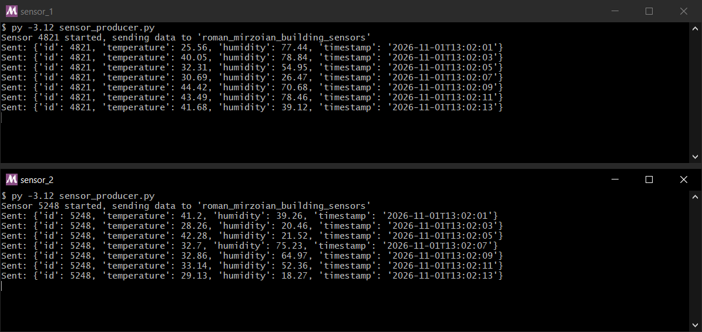
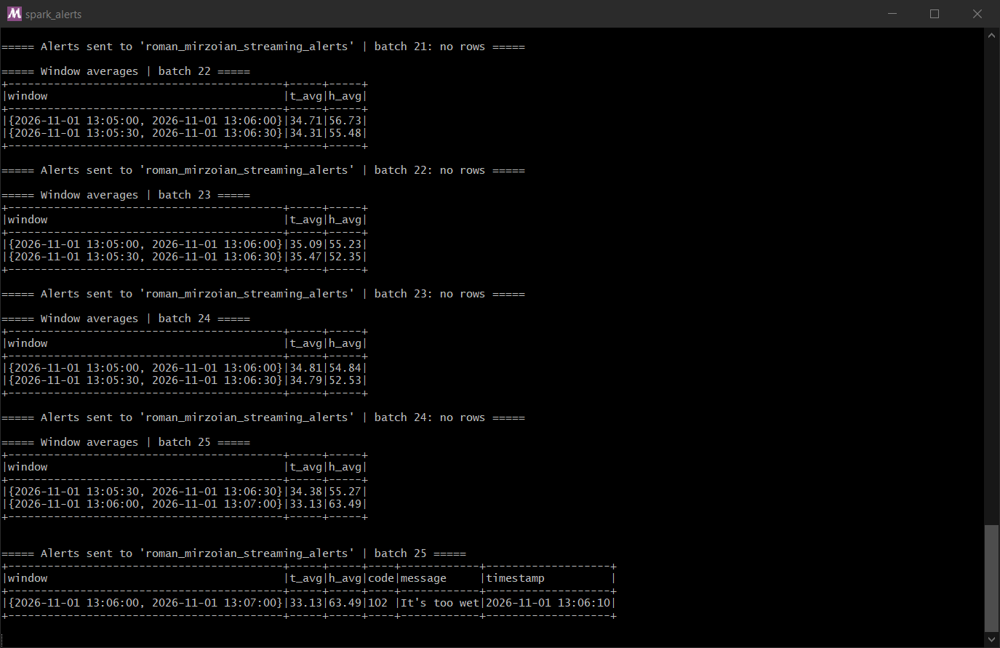
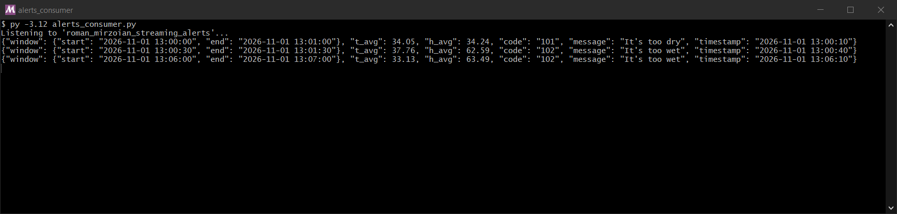

# goit-de-hw-06

Spark Structured Streaming: моніторинг IoT-датчиків з Kafka і запис алертів у Kafka-топік.

## Структура

| Файл | Опис |
|---|---|
| `configs.py` | Назви топіків, файл умов алертів, налаштування підключення до Kafka |
| `create_topics.py` | Створює топіки `roman_mirzoian_building_sensors` і `roman_mirzoian_streaming_alerts` |
| `sensor_producer.py` | Імітує один датчик: випадковий постійний `id`, кожні 2 с надсилає `temperature` (25–45), `humidity` (15–85) і `timestamp` |
| `spark_alerts.py` | Spark Structured Streaming: читає потік датчиків, рахує середні у sliding window, визначає алерти через cross join з умовами і пише їх у Kafka |
| `alerts_conditions.csv` | Умови алертів (мінімум і максимум для температури й вологості, код і повідомлення; `-999` — межа не використовується) |
| `alerts_consumer.py` | Читає топік алертів і виводить повідомлення — щоб переконатися, що алерти справді записані |
| `download_jars.py` | Завантажує jar-файли Spark Kafka-конектора з Maven Central у `jars/` (потрібно на Windows) |
| `windows_fs/` | Допоміжна файлова система для запуску на Windows без `winutils.exe` (див. нижче) |

## Як працює `spark_alerts.py`

1. **Потік даних.** `readStream` з топіка `building_sensors`, JSON розбирається за схемою `id`, `temperature`, `humidity`, `timestamp`.
2. **Агрегація.** `withWatermark("timestamp", "10 seconds")` і `groupBy(window("timestamp", "1 minute", "30 seconds"))` — sliding window довжиною 1 хвилина з кроком 30 секунд; для кожного вікна рахуються `t_avg` і `h_avg`.
3. **Умови алертів** зчитуються з `alerts_conditions.csv`, тож їх можна змінювати без зміни коду.
4. **Визначення алертів.** Середні значення кожного вікна об'єднуються з усіма умовами через `crossJoin`, після чого лишаються рядки, де `t_avg` і `h_avg` потрапляють у межі умови (межа `-999` ігнорується).
5. **Запис у Kafka.** Алерти серіалізуються в JSON (`window`, `t_avg`, `h_avg`, `code`, `message`, `timestamp`) і пишуться в топік `roman_mirzoian_streaming_alerts`.

Використано режим виводу `update`: після кожного мікробатчу (10 с) Spark видає оновлені вікна, тому алерт з'являється одразу, як тільки середнє вікна виходить за межі, не чекаючи закриття вікна.

Для наочності середні значення й алерти також друкуються в консоль.

## Виконання

Усі скрипти запускались локально

### 1. Генерація даних датчиків

Два одночасні запуски `sensor_producer.py` — два датчики з різними `id`. Кожен кожні 2 секунди надсилає в `roman_mirzoian_building_sensors` температуру, вологість і час.

### 2. Середні значення та алерти в Spark

Вивід `spark_alerts.py`. Блоки **Window averages** — результат агрегації: для кожного sliding window (1 хвилина, крок 30 секунд) середня температура `t_avg` і вологість `h_avg`; кожна подія потрапляє у два вікна, що перекриваються. Блоки **Alerts sent to ...** — результат cross join з `alerts_conditions.csv` і фільтрації, тобто саме ті записи, що відправляються в Kafka. У батчі 25 середня вологість вікна 13:06–13:07 становить 63.49 %, що потрапляє в умову `60–100` → алерт `102 It's too wet`. Якщо жодне середнє не виходить за межі, батч алертів порожній (`no rows`).

### 3. Алерти в Kafka-топіку

`alerts_consumer.py` читає топік `roman_mirzoian_streaming_alerts` і показує повідомлення в тому вигляді, в якому їх записав Spark. Останній рядок — той самий алерт `102` з батчу 25 на попередньому скриншоті. Перші два рядки алерти з попереднього тестового запуску, які ще не були прочитані.

